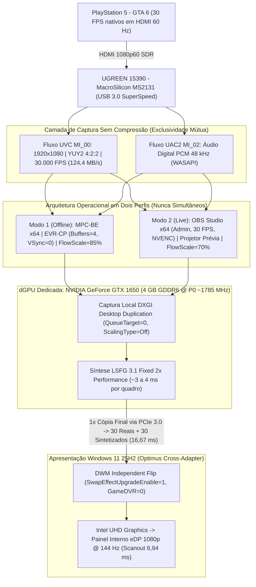
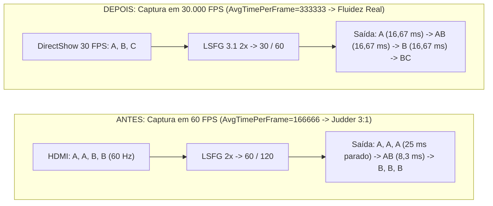

# Engenharia de Baixa Latência e Frame Generation (`30 -> 60 FPS`) — PS5 / GTA 6 no Windows 11

-0078D4?style=flat-square&logo=windows11)
-10B981?style=flat-square)
-76B900?style=flat-square&logo=nvidia)
-8B5CF6?style=flat-square)


Documentação técnica completa, perfis sanitizados de referência e automação PowerShell/`nvapi64.dll` para jogar e transmitir títulos nativos de **30 FPS do PlayStation 5 (GTA 6)** a **60 FPS reais e contínuos (`30 / 60`)** com o **menor input lag fisicamente possível** através de placa de captura USB 3.0 em notebooks híbridos **NVIDIA Optimus** (`144 Hz` SDR).

---

## Sumário Navegável

- [1. Visão Geral Executiva e Problema de Engenharia](#1-visão-geral-executiva-e-problema-de-engenharia)
- [2. Ambiente de Hardware e Software Auditado](#2-ambiente-de-hardware-e-software-auditado)
- [3. Arquitetura da Cadeia de Sinal (Diagramas Mermaid)](#3-arquitetura-da-cadeia-de-sinal-diagramas-mermaid)
- [4. Comparativo Completo: Antes vs. Depois (FPS, Frame Time e Clocks)](#4-comparativo-completo-antes-vs-depois-fps-frame-time-e-clocks)
- [5. Decomposição Camada por Camada da Redução de Input Lag (em ms)](#5-decomposição-camada-por-camada-da-redução-de-input-lag-em-ms)
- [6. Análise Física Honesta: O Piso Irredutível de `33,33 ms` vs. Latência Parasita](#6-análise-física-honesta-o-piso-irredutível-de-3333-ms-vs-latência-parasita)
- [7. Operação Dual-Profile: Modo Offline (MPC-BE) vs. Modo Live (OBS Studio)](#7-operação-dual-profile-modo-offline-mpc-be-vs-modo-live-obs-studio)
- [8. Guia Rápido de Implantação (Quick Start)](#8-guia-rápido-de-implantação-quick-start)
- [9. Estrutura do Repositório](#9-estrutura-do-repositório)
- [10. Segurança e Privacidade (Zero Segredos)](#10-segurança-e-privacidade-zero-segredos)

---

## 1. Visão Geral Executiva e Problema de Engenharia

Conectar um **PlayStation 5** rodando um título de **30 FPS** (como **GTA 6**) a um notebook Windows 11 via placa de captura USB 3.0 e ativar geração de quadros (*Frame Generation*) com as configurações padrão produz, simultaneamente, **cinco falhas graves de engenharia**:

1. **Colapso catastrófico para `~15 FPS` (`~66,7 ms/frame`):** Em notebooks **NVIDIA Optimus** sem MUX Switch, `PreferredGpuId = 0` (*Automático*) aliado a `CaptureApi = WGC` faz o Lossless Scaling executar na **`Intel UHD Graphics` (`128 MB` VRAM compartilhada)** em vez da **`GTX 1650`**, saturando o barramento e reduzindo a taxa de quadros à metade do console original.
2. **Armadilha dos quadros duplicados (`60 / 120` com *judder* severo):** O PS5 encapsula jogos de 30 FPS dentro de um sinal elétrico HDMI de `60 Hz` repetindo cada quadro duas vezes (`A, A, B, B`). Quando o OBS/player abre a captura em `60 FPS`, o `LSFG 2x` interpola metade das vezes pares idênticos (`A -> A = A`) e metade transições reais (`A -> B`), exibindo padrão assimétrico `3:1` ($25,0\text{ ms}$ congelado + $8,33\text{ ms}$ intermediário) com o dobro de consumo de GPU e banda USB.
3. **Downclock silencioso de `P-state` (`645 MHz` vs. `1785 MHz`):** Medições reais via `nvidia-smi` comprovaram que, sob carga intermitente de 30 FPS no OBS, o driver NVIDIA no modo padrão derrubava a GTX 1650 para **`645 MHz`** (**2,77x abaixo** do boost máximo de `1785 MHz`), triplicando o tempo de *compute shader* do LSFG de `~3–4 ms` para `~10–12 ms` (**+7 ms a +9 ms** de atraso puro).
4. **Passes redundantes de shader e sinalização VRR indevida:** `ScalingType = LS1` (`Sharpness = 2`) ligado sobre sinal nativo `1080p -> 1080p` (introduzindo custo extra de GPU e *ringing* no HUD) e `GsyncSupport = true` em tela eDP sem suporte a G-Sync.
5. **Acúmulo de filas parasitas no Windows, DWM e OBS:** `SwapEffectUpgradeEnable = 0` (DWM preso em *BitBlt* legado, +8 a +16 ms), `GameDVR_Enabled = 1` (+3 a +8 ms), `QueueTarget = 1` (+16,7 a +33,3 ms), `Suspensão Seletiva USB = Ativada` e uso desnecessário do compositor completo do OBS Studio (+20 a +35 ms) mesmo durante sessões de gameplay offline.

Este repositório documenta e automatiza a eliminação dessas cinco camadas parasitas, definindo a arquitetura-alvo para estabilizar **`30 / 60 FPS` reais** com redução estimada de **`~55 ms` a `> 95 ms` de latência parasita acumulada**.

---

## 2. Ambiente de Hardware e Software Auditado

| Subsistema | Especificação Técnica Exata |
| :--- | :--- |
| **Fonte / Console** | **PlayStation 5** rodando **GTA 6** (`30 FPS` nativos encapsulados em link HDMI `1920x1080 @ 60 Hz` SDR, RGB Limitado / Rec. 709) |
| **Placa de Captura** | **`UGREEN 15390`** — ASIC **MacroSilicon `MS2131`** (`USB\VID_345F&PID_2131`), USB 3.0 SuperSpeed (`5 Gbps`), vídeo raw **`YUY2 4:2:2`** (`124,42 MB/s` em 30 fps; `248,83 MB/s` em 60 fps) + áudio digital WASAPI `48 kHz` |
| **Sistema / CPU / RAM** | **Windows 11 25H2 (Build 26200)** — **Intel Core i5-10300H** (`4C / 8T`) + `8 GB` RAM DDR4 |
| **Topologia Gráfica (Optimus)** | **`Intel UHD Graphics`** (conectada via eDP ao painel interno **`1920x1080 @ 144 Hz` SDR**, *scanout* de `6,94 ms`, sem G-Sync) + **`NVIDIA GeForce GTX 1650`** (`4 GB GDDR6`, Turing `TU117`, boost máx. **`1785 MHz`**, sem Tensor Cores) |
| **Interpolador Óptico** | **Lossless Scaling** — Motor **`LSFG 3.1`** (`Modo Fixado 2x`, `DXGI`, `QueueTarget = 0`, `LSFGSize = PERFORMANCE`, `PreferredGpuId = 2`) |
| **Players Dual-Profile** | **Modo Offline:** `MPC-BE 1.9.3 x64` (`EVR-CP` + `MPC Audio Renderer` WASAPI) \| **Modo Live:** `OBS Studio x64` (`NVENC` + Projetor em Tela Cheia) |

---

## 3. Arquitetura da Cadeia de Sinal (Diagramas Mermaid)

### 3.1 Topologia Otimizada Ponta-a-Ponta (NVIDIA Optimus + USB 3.0 + LSFG 3.1)



### 3.2 Eliminação do Bug `60 / 120` (Quadros Duplicados) -> Cadência Limpa `30 / 60`



---

## 4. Comparativo Completo: Antes vs. Depois (FPS, Frame Time e Clocks)

> [!NOTE]
> **Transparência Metodológica (Diagnósticos Medidos vs. Configuração-Alvo Estimada):** Os dados de `~15 FPS` (queda na iGPU), clock preso em `645 MHz` (`nvidia-smi` sob carga no OBS vs. `1785 MHz` máx.), contador `60 / 120` (`AvgTimePerFrame=166666`) e erro `0x800705AA` nos logs do OBS foram **medidos e diagnosticados diretamente na máquina real**. As colunas **DEPOIS** representam a **configuração-alvo completa** provida por `configs/` e `scripts/`, e os valores de redução de *input lag* em milissegundos (`ms`) nas seções 5 e 6 são **estimativas analíticas teóricas** baseadas em períodos de quadro, filas de swapchain e escalonamento de clock (não houve medição óptica ponta-a-ponta via sensor LDAT/câmera de alta velocidade).

| Métrica / Subsistema | ANTES (Colapso Auto iGPU) | ANTES (OBS 60 FPS s/ Tuning) | DEPOIS — Modo Live (Alvo: OBS + LSFG) | DEPOIS — Modo Offline (Alvo: MPC-BE + LSFG) |
| :--- | :--- | :--- | :--- | :--- |
| **GPU Executando LSFG** | `Intel UHD Graphics` (`PreferredGpuId=0`) | `GTX 1650` (c/ downclock P-state) | **`GTX 1650` (`PreferredGpuId=2`)** | **`GTX 1650` (`PreferredGpuId=2`)** |
| **Clock Gráfico** | iGPU compartilhada (128 MB VRAM) | **`645 MHz` medidos** (2,77x abaixo do boost!) | **`~1785 MHz` (`P0` Max Perf DRS)** | **`~1785 MHz` (`P0` Max Perf DRS)** |
| **Formato de Captura USB** | `1080p60` (`248,8 MB/s`) | `1080p60` (`AvgTime=166666`) | **`1080p30 YUY2` (`124,4 MB/s`)** | **`1080p30 YUY2` (`AvgTime=333333`)** |
| **Contador Lossless Scaling** | `~15 FPS` medidos (colapso) | `60 / 120` medidos (pares `A->A` falsos) | **`30 / 60` reais e constantes** | **`30 / 60` reais e constantes** |
| **Frame Time Efetivo Exibido** | `~66,7 ms` (injogável) | Assimetria `25,0 ms` / `8,33 ms` (*judder*) | **`16,67 ms` contínuos (60 Hz reais)** | **`16,67 ms` contínuos (60 Hz reais)** |
| **Tempo de Shader LSFG 3.1 (est.)** | Saturado na iGPU (`~66,7 ms` ciclo total) | `~10–12 ms` (`645 MHz` + `LS1` + `Balanced`) | **`~3–4 ms`** (`Performance`, `Flow=70%`) | **`~3–4 ms`** (`Performance`, `Flow=85%`) |
| **API de Captura & Fila** | `WGC` + `QueueTarget = 1` | `WGC/DXGI` + `QueueTarget = 1` | **`DXGI` + `QueueTarget = 0`** | **`DXGI` + `QueueTarget = 0`** |
| **Apresentação DWM Windows** | *BitBlt* legado + *GameDVR* ativo | *BitBlt* legado + *GameDVR* ativo | **Flip Model + GameDVR/FSE Off** | **Flip Model + GameDVR/FSE Off** |

---

## 5. Decomposição Camada por Camada da Redução de Input Lag (em ms)

A tabela abaixo consolida a **redução estimada de latência** de cada intervenção arquitetural sobre o caminho crítico entre a entrega USB e o *scanout* de `144 Hz`:

| Camada do Pipeline | Estado Anterior (Diagnosticado) | Configuração-Alvo Otimizada | Redução Estimada de Input Lag |
| :--- | :--- | :--- | :--- |
| **1. Roteamento Optimus & Motor LSFG** | `PreferredGpuId=0` (queda medida p/ ~15 FPS / ~66,7 ms na iGPU) + `WGC` + `LS1` + `BALANCED` | `PreferredGpuId=2` (`GTX 1650`) + `DXGI` + `ScalingType=Off` + `PERFORMANCE` | **Elimina colapso de ~66,7 ms** (shader est. em **~3–4 ms**) |
| **2. Fila Interna do Lossless Scaling** | `QueueTarget = 1` (retém 1 quadro extra de captura para *smoothing*) | **`QueueTarget = 0`** + `MaxFrameLatency = 1` + `SyncMode = OFF` | **`-16,7 ms` a `-33,3 ms` (est.)** |
| **3. Clocks e Fila de Driver NVIDIA (`nvapi64.dll`)** | *Optimal Power* rebaixando GTX 1650 para **`645 MHz`** (medido) + fila padrão | Perfis DRS (`0x1` *Max Perf* -> **`~1785 MHz`**, VSync *Force Off* `0x08416747`, *PreRender* = `1`) | **`-7,0 ms` a `-9,0 ms` (est.)** |
| **4. Apresentação DWM (Windows 11 25H2)** | `SwapEffectUpgradeEnable = 0` (janelas D3D10/11 *blt-model* caem em *BitBlt*) | **`SwapEffectUpgradeEnable = 1`** (promove swapchains D3D10/11 *blt-model* p/ *Flip Model*\*) | **`-8,0 ms` a `-16,0 ms` (est. condicional\*)** |
| **5. Hooks GameDVR, FSE Global & USB** | `GameDVR_Enabled = 1`, `AppCaptureEnabled = 1` + `Suspensão Seletiva USB = Ativada` | **`GameDVR_Enabled = 0`**, **`AppCaptureEnabled = 0`**, **`GameDVR_FSEBehaviorMode = 2`**, `AutoGameMode = 1`, **`USB Suspend = 0x0`** | **`-3,0 ms` a `-8,0 ms` (est.)** + zero *micro-stutter* USB |
| **6. Bypass do Compositor (Modo Fora de Live)** | Jogar sempre pela prévia do OBS Studio (grafo de cena + *staging* + áudio OBS) | **`MPC-BE 1.9.3 x64`** direto em DirectShow (`EVR-CP`, `Buffers=4`, `VSync=0`, `WASAPI`) | **`-20,0 ms` a `-35,0 ms` adicionais (est.)** |
| **TOTAL DE LATÊNCIA PARASITA REMOVIDA** | **Acúmulo severo de filas de software e downclock** | **Pipeline enxuto próximo ao limite físico de amostragem** | **`~55 ms` a `> 95 ms` (redução estimada)** |

*\*Nota técnica sobre a Camada 4:* `SwapEffectUpgradeEnable=1` converte swapchains em janela DirectX 10/11 *blt-model* para *Flip Model*; como o `LosslessScaling.exe` já opera nativamente em DXGI *Flip Model* e o `EVR-CP` do MPC-BE utiliza `D3D9Ex`, esse ganho de `-8 a -16 ms` é condicional e atua especificamente onde janelas D3D10/11 *blt-model* entrariam na cadeia.

---

## 6. Análise Física Honesta: O Piso Irredutível de `33,33 ms` vs. Latência Parasita

Por rigor de engenharia, é fundamental distinguir o **limite físico inferior** de qualquer arquitetura de interpolação temporal externa `30 -> 60 FPS`:

- **O Piso Algorítmico de Causalidade (`33,33 ms`):** Para sintetizar o quadro intermediário $F_{t+0.5}$ situado espacialmente entre o quadro atual $F_t$ e o próximo quadro $F_{t+1}$ de um sinal HDMI fechado (onde não há acesso aos vetores de movimento internos da engine do PS5), o interpolador **precisa aguardar a chegada física de $F_{t+1}$**. A uma taxa nativa de $30\text{ FPS}$, o intervalo entre dois quadros reais consecutivos é exatamente:
  $$T_{\text{piso}} = \frac{1000\text{ ms}}{30} = 33,33\text{ ms}$$
- **O que a nossa engenharia faz:** Esse intervalo de $33,33\text{ ms}$ (somado aos `~3,5 ms` estimados de síntese na GTX 1650 a `1785 MHz` e aos `6,94 ms` do *scanout* de `144 Hz`) constitui o **custo algorítmico e físico mínimo de amostragem** para transformar 30 FPS em 60 FPS reais. Antes da otimização, somavam-se **mais `~55 ms a > 95 ms` estimados de atrasos puramente parasitas** acima desse piso (filas de captura, *BitBlt*, hooks GameDVR/FSE, *downclock* para `645 MHz` e composição desnecessária do OBS). Ao **eliminar a latência parasita**, o controle DualSense passa a responder no limite prático permitido pela física de sinais.

> Para a dedução matemática completa, análise binária do `VIDEOINFOHEADER` e arquitetura Optimus/NVAPI, leia **[`docs/01-engenharia-de-latencia-e-frames.md`](docs/01-engenharia-de-latencia-e-frames.md)**.

---

## 7. Operação Dual-Profile: Modo Offline (MPC-BE) vs. Modo Live (OBS Studio)

| Característica | Modo 1: Fora de Live (`MPC-BE x64`) | Modo 2: Em Live / Gravação (`OBS Studio x64`) |
| :--- | :--- | :--- |
| **Quando utilizar** | **100% das sessões de gameplay solo/offline** | Quando estiver transmitindo (Twitch/YouTube) ou gravando via NVENC |
| **Caminho de Vídeo & Áudio** | DirectShow -> `EVR-CP` (`Buffers=4`, `VSync=0`) + `MPC Audio Renderer` (WASAPI) | DirectShow (`30 FPS`, `YUY2`, `Buffering=Off`) -> Projetor de Prévia em Tela Cheia |
| **Perfil Lossless Scaling** | `MPC-BE - GTA 6 (60 FPS)` (`LSFGFlowScale = 85%`) | `OBS - GTA 6 (60 FPS)` (`LSFGFlowScale = 70%` — reserva margem p/ NVENC) |
| **Latência Ponta-a-Ponta** | **Mínima absoluta** (**-20 a -35 ms** menor que o OBS) | Baixa latência otimizada compatível com codificação simultânea |
| **Contador Alvo (`Ctrl+Alt+S`)** | **`30 / 60`** | **`30 / 60`** |

> [!CAUTION]
> **Regra Crítica de Exclusividade DirectShow:** `mpc-be64.exe` e `obs64.exe` **JAMAIS podem ficar abertos ao mesmo tempo** (nem mantendo múltiplas fontes `dshow_input` da `UGREEN 15390` no OBS). A disputa simultânea pelo endpoint USB 3.0 causa tela preta ou erro `0x800705AA (Insufficient system resources)`.

---

## 8. Guia Rápido de Implantação (Quick Start)

1. **Conecte o hardware corretamente:** PS5 em `1080p` (`HDR Off`, `RGB Limitado`, `HDCP Off`) -> `UGREEN 15390` conectada **diretamente em porta USB 3.0 azul/SuperSpeed** do notebook (sem hub) e tela do Windows em **`144 Hz`**.
2. **Aplique as otimizações de Sistema e Driver NVIDIA** (PowerShell como **Administrador**):
   ```powershell
   # Otimiza DWM Flip (SwapEffectUpgradeEnable=1), afinidade dGPU, GameDVR/AppCapture Off,
   # GameDVR_FSEBehaviorMode=2 (desliga Fullscreen Optimizations globalmente), Game Mode e USB Suspend (com backup JSON)
   .\scripts\Optimize-WindowsLowLatency.ps1

   # Grava perfis nvapi64.dll (Max Performance ~1785 MHz, VSync Force Off, Max Pre-Rendered Frames = 1)
   .\scripts\Configure-NvidiaDrsLowLatency.ps1
   ```
3. **Aplique os perfis de referência:**
   - Copie [`configs/lossless-scaling/Settings.reference.xml`](configs/lossless-scaling/Settings.reference.xml) para `%LOCALAPPDATA%\Lossless Scaling\Settings.xml`.
   - Configure o MPC-BE e o OBS Studio seguindo o passo a passo de **[`docs/02-guia-instalacao-e-operacao.md`](docs/02-guia-instalacao-e-operacao.md)** (garantindo **`1920x1080`, `YUY2`, `30.000 FPS`**).
4. **Valide toda a cadeia em tempo real** (somente leitura, sem precisar de Admin):
   ```powershell
   .\scripts\Test-CapturePipelineHealth.ps1
   ```

---

## 9. Estrutura do Repositório

```text
ps5-lossless-scaling-low-latency/
├── README.md                                       # Visão arquitetural, diagramas, métricas Antes vs. Depois e Quick Start
├── LICENSE                                         # Licença MIT
├── .gitignore                                      # Proteção contra arquivos temporários, backups e tokens privados do OBS
├── docs/
│   ├── 01-engenharia-de-latencia-e-frames.md       # Estudo técnico: matemática 30-em-60Hz, LSFG 3.1, Optimus, P-states e YUY2
│   └── 02-guia-instalacao-e-operacao.md            # Manual operacional passo a passo (MPC-BE & OBS) + Troubleshooting
├── configs/
│   ├── lossless-scaling/
│   │   └── Settings.reference.xml                  # Perfis sanitizados LSFG 3.1 (MPC-BE Flow=85% e OBS Flow=70%, Queue=0)
│   ├── mpc-be/
│   │   └── mpc-be64.reference.ini                  # Perfil EVR-CP + WASAPI + VIDEOINFOHEADER exato para 1080p YUY2 30.000 FPS
│   └── obs-studio/
│       └── basic.video-reference.ini               # Seções sanitizadas [Video]/[Audio]/[SimpleOutput] em 30 FPS (SEM tokens)
└── scripts/
    ├── Optimize-WindowsLowLatency.ps1              # Auditoria, backup JSON, aplicação e rollback de DWM Flip, GameDVR e USB
    ├── Configure-NvidiaDrsLowLatency.ps1           # Automação C#/PowerShell via nvapi64.dll oficial (P0 1785 MHz, VSync Off)
    └── Test-CapturePipelineHealth.ps1              # Diagnóstico 100% somente-leitura de GPU, clocks, USB PnP e DirectShow
```

---

## 10. Segurança e Privacidade (Zero Segredos)

- **Zero Credenciais ou Tokens:** Nenhum arquivo deste repositório contém chaves de transmissão, `RefreshToken`, `Token`, `CookieId` ou identificadores de conta do OBS Studio; todos os caminhos utilizam variáveis padrão de ambiente (`%USERPROFILE%`, `%LOCALAPPDATA%`, `%APPDATA%`).
- **Scripts Auditáveis e Reversíveis:**
  - `Test-CapturePipelineHealth.ps1` é **100% somente leitura**;
  - `Optimize-WindowsLowLatency.ps1` possui modos `-CheckOnly` e `-WhatIf`, gera backup automático em JSON (`.\backups\`) antes de qualquer escrita e reverte integralmente o estado anterior via `-RestoreFromBackup`;
  - `Configure-NvidiaDrsLowLatency.ps1` possui modos `-CheckOnly` e `-WhatIf`, atua apenas nos perfis individuais dos 3 executáveis (`losslessscaling.exe`, `mpc-be64.exe`, `obs64.exe`) e pode ser revertido a qualquer momento em *Painel de Controle da NVIDIA -> Gerenciar configurações em 3D -> Configurações do programa -> Restaurar*.
